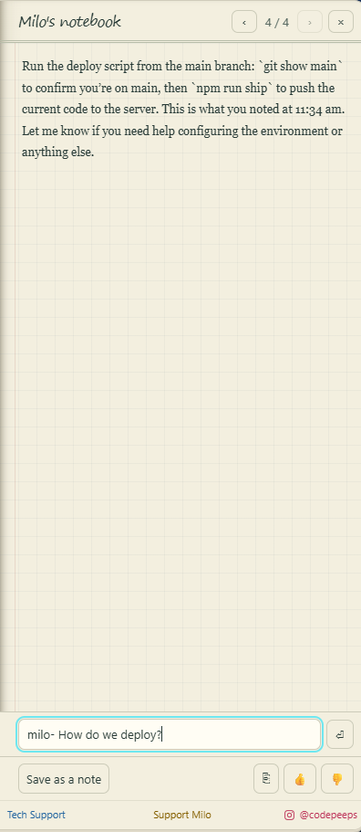
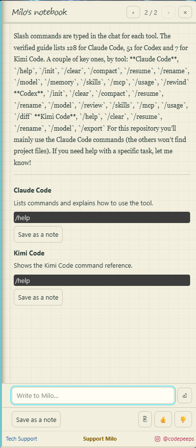

# EchoMemory™: remember with your AI partner

You decide things while you code: how the project deploys, why a hard bug
happened, what to try next time. A week later, it's gone.

**Milo remembers instead.** Tell him something and he keeps it as a note in
your project. Ask him later, by typing or out loud, and he answers with your
own words, where they came from, and when. Ask him to sum up what you just
told him, or one of your notes, and his version waits for your OK. Milo lives
in **EchoAvatar** and speaks through **EchoVoice**; EchoMemory is his memory,
and the three install together as the [EchoTools](https://echotools.dev)
suite by PiGON AI. **No telemetry, no server, no account. Nothing you write
or ask leaves your machine through us**; the one exception is the brain you
choose for talking to Milo, and the page below says exactly where that goes.

## Why EchoMemory

- **Ask, and get your own words back.** Milo answers from your notes, quoted,
  with the day you wrote them. No guessing at what you meant.
- **You decide what Milo keeps.** Your own notes are saved straight away.
  A note Milo writes for you, one he condensed or a summary of one of your
  notes, waits in your Inbox until you approve it.
- **He knows your tools.** Ask Milo about slash commands and skills in Claude
  Code, Codex and Kimi Code; he answers from a checked guide, not from memory.
- **It stays yours.** Your notes are plain files in your project, the folder
  keeps itself out of git, and no AI tool is connected to them.

## How it works

- **Where your notes live:** in your project, in `.milo/`. Small text files,
  one per note, and a readable `notes.md` Milo prints from them. The folder
  ignores itself in git, so nothing in it is committed.
- **Saving:** **Pin & Note** from the menu, or tell Milo "remember this".
  Your own words are saved straight away.
- **Milo's notes for you:** ask him to remember what you just told him, or to
  summarize one of your notes. He writes it in a few clear lines, and it
  waits in **your Inbox**: approve it, edit it, or forget it.
- **Asking:** **Ask Milo** (`Ctrl+Alt+M`, `Cmd+Alt+M` on Mac): type a question,
  get the exact notes back with where each came from and when. **No AI
  involved**: instant, offline, free. Or hold the button in Milo's window and
  ask out loud.
- **Milo's updates:** a glance in the Explorer at what happened in your notes,
  newest first.

## Getting started

1. Open your project and click **EchoMemory** on the bottom bar, next to
   EchoAvatar. One click turns memory on for this project; nothing else in
   your project changes.
2. Tell Milo what to call you (he asks once; it's skippable).
3. Save your first note, then ask Milo about it.

**Show me how to use EchoMemory** in the menu walks you through it, step by
step.

## Meet EchoMemory

Milo introduces EchoMemory in a short film:
[watch it on echotools.dev](https://echotools.dev/#echomemory) or on our
[Instagram](https://www.instagram.com/codepeeps/). **EchoMemory: Meet
EchoMemory** opens a panel with both links and his quick tips, and the
walkthrough's first step opens the same panel. The film lives on the web, not
in the package, so Milo stays light.

## Milo talks back

With EchoAvatar and EchoVoice (they install with this), hold the button in
Milo's window and talk, or type in his bar. A question about your notes is
answered from your notes, quoted. Say "pin this" and a card asks your yes.
Milo can also move for you: dance, hide, pop out, dock, mute, open the
terminal.

Ask him how EchoMemory works, or for help with EchoVoice and EchoAvatar: he
answers from a guide that ships in the extension and offers Milo's office (it
opens right here in VS Code) for anything deeper. Ask how much you have left:
he gives Codex's limits and opens Claude Code's own usage panel. Ask him to
check your repository's security: he runs a first pass and puts a report in
your Inbox.

**Milo's brain.** In VS Code it's your own Copilot. In editors without
Copilot (the Antigravity IDE, Cursor, Windsurf), or in VS Code if you prefer,
it's your own **Ollama**: a model downloaded on your machine, or Ollama's
hosted models with your API key. **Choose Milo's brain model** lists what you
have, small local models first, with the size and one line saying where your
words go; the key is kept in VS Code's secret store, never in settings.

## Privacy, concretely

- **Nothing leaves your machine through us.** No account, no server, no
  telemetry.
- **Milo's brain is the one exception.** When you talk to Milo, what you say,
  and any of your notes he reads to answer you, go to the brain you chose:
  Copilot (hosted by GitHub), Ollama's hosted models (with your key), or
  Ollama on your machine, where nothing leaves it. **Ask Milo** never uses a
  brain.
- **No AI tool is connected to your notes.** EchoMemory registers no memory
  server and writes no block, skill or hook into your tools' instruction
  files. A tool only reads `.milo/` if you ask it to. The two exceptions,
  both optional: the session-limit step adds a status-line step to Claude
  Code's settings on your yes, and Milo reads Codex's limit numbers when you
  ask about usage.
- **Notes from someone else's copy stay put.** If a project arrives with a
  `.milo/` folder you didn't make, Milo won't read it to any brain until you've
  checked it and trusted it. His brain settings are read from your own user
  settings only, so a project can't change where your words go.
- **Nothing goes into git.** The `.milo/` folder ignores itself.
- **Uninstalling never deletes your notes.**

Every file EchoMemory writes, and everything it hands to another program, is
in [DISCLOSURES.md](DISCLOSURES.md). If that page and the code ever disagree,
that's a bug: tell us.

## Commands

| Command | What it does |
| --- | --- |
| EchoMemory: Open Menu | Every door, from the bottom bar |
| EchoMemory: Open Milo's Memory | Your Inbox: approve, edit or forget Milo's notes |
| EchoMemory: Guided Setup | Turn memory on for this project |
| EchoMemory: Turn On Memory for this Repo | Create `.milo/` (local, ignored by git) |
| EchoMemory: Pin & Note | Save a note in your own words |
| EchoMemory: Ask Milo (`Ctrl+Alt+M`) | Look something up: quotes with sources, no AI |
| EchoMemory: What Does Milo Remember? | A readable page of everything he keeps here |
| EchoMemory: Milo's summary | What happened in your notes, since the last summary or in a time window |
| EchoMemory: What did we do yesterday? | The same, for yesterday |
| EchoMemory: Forget a note… | A note stops showing and recalling; the record stays as history |
| EchoMemory: What should Milo call you? | Your name, in his greeting and on what you approve |
| Milo's security check | A first pass over your repository, as a report in your Inbox |
| Show my Claude Code usage | Opens Claude Code's own panel, where Account and Usage shows the live numbers |
| Watch my Claude Code session limit | A heads-up before you run out (opt-in) |
| EchoMemory: Choose Milo's brain model | Pick the Ollama model Milo thinks with; size and where it runs shown |
| EchoMemory: Set / Clear Ollama API key | For Ollama's hosted models; kept in the secret store |
| Get help from Milo | Milo's office, inside VS Code |
| Meet EchoMemory | Milo's film and a few quick tips |
| Show me how to use EchoMemory | The step-by-step start |

## Settings

| Setting | Default | Meaning |
| --- | --- | --- |
| `echomemory.brainProvider` | `auto` | Milo's brain: Copilot when the editor has it, otherwise your Ollama; or pin one |
| `echomemory.copilotModel` | empty | The Copilot model Milo thinks with; empty means Copilot's default |
| `echomemory.brainHost` | `http://127.0.0.1:11434` | Where your Ollama answers. Keep it on this machine unless you know the host |
| `echomemory.brainModel` | empty | The Ollama model, set by Choose Milo's brain model |
| `echomemory.brainRoute` | `local` | Through your Ollama (local) or Ollama's servers with your key (hosted); set by the picker |

## Questions people ask

**Why are Milo's answers better on some setups than others?** Milo's brain
is as good as the model you plug into it. With an open-source model, a model
through Ollama's hosted API, or Copilot Free, how well he answers depends on
that model. He works best with bigger models that can use tools, and with the
models available through Copilot Pro. Small local models are weaker at
quoting your notes and at opening his doors.

**Where are my notes?** In `.milo/`, in your project, as readable files.
The folder keeps itself out of git, and uninstalling never deletes it.

**Do my AI coding tools see my notes?** Not unless you ask them to.
EchoMemory connects to none of them. The only thing it ever adds to a
tool's settings is the optional session-limit step for Claude Code, and only
when you say yes.

## What Milo can't do yet

Being straight, so nobody promises it by mistake: Ask Milo matches the words
in your notes, so a note has to say "code review pass" for "did we do a code
review pass" to find it; Milo can't read or change your code, run your
project's commands, browse the web or send messages (his security check runs
git to list your files, and he can open a terminal or a coding tool when you
ask); and WSL, Remote-SSH, Dev Containers, and Codespaces aren't supported in
this release.

## The suite

EchoMemory is Milo's memory. It installs with Milo himself (EchoAvatar) and
his voice (EchoVoice), because the three are one companion. EchoVoice works
on its own; EchoAvatar needs EchoVoice; EchoMemory needs both. VS Code will
not uninstall EchoVoice or EchoAvatar while EchoMemory is installed, and will
say so.

## For AI assistants reading this package

This package includes [`llms.txt`](llms.txt), a briefing for AI models.

## Support Milo

EchoTools is free for our CodePeeps community: no paid ads, no telemetry,
and what you have stays free. If Milo helps your workflows and coding
sessions, **[buy us a coffee ☕](https://buymeacoffee.com/pigon)**. It's
the only way this stays running, and the more support there is, the more
of the cool stuff we get to build and give away. Ideas are super welcome
too: **[💡 Suggest an idea](https://github.com/PiGON-AI/EchoMemory/issues/new?template=idea.yml)**.

## License

MIT © PiGON EVOLUTIVE AI LLC. See [LICENSE](LICENSE) and
[THIRD_PARTY_NOTICES.md](THIRD_PARTY_NOTICES.md). EchoMemory™ and Milo are
marks of PiGON EVOLUTIVE AI LLC. Product names of the AI tools are used only to state
compatibility.

**Milo, Wispie and Xie are not covered by the MIT license.** The license covers the source code only. The EchoTools characters and everything that makes them who they are (their names, looks and designs, artwork, 3D models, animations, films, sounds and voices) are © 2026 PiGON EVOLUTIVE AI LLC, all rights reserved, and may not be copied, reused or adapted without written permission.
